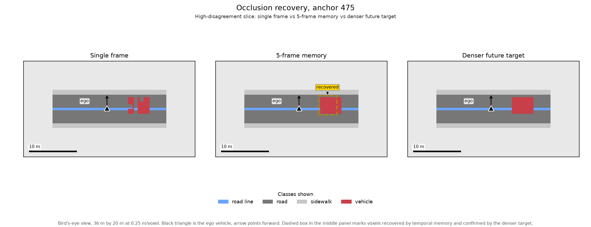
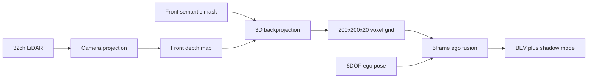

# Temporal 3D Semantic Occupancy Grid

[](https://github.com/donaldng05/carla/actions)
[](https://www.python.org/)
[](https://mypy-lang.org/)
[](https://github.com/astral-sh/ruff)
[](https://colab.research.google.com/github/donaldng05/carla/blob/main/notebooks/phase2_5_scenario_memory_eval.ipynb)
[](LICENSE)

> Test snapshot (Oct 2026): 80 tests, 85% branch coverage. Live status is in CI above.

A perception-centric autonomous driving system engineered to maintain spatial awareness under **severe visual occlusion** and **sparse sensor regimes** in dense traffic.

Instead of relying on fragile 3D bounding-box tracking that flickers when obstacles block line of sight, this system constructs a **3D semantic occupancy grid** from sparse LiDAR-projected depth and camera semantic segmentation, then executes **5-frame temporal ego-motion fusion** to retain persistent spatial memory across vehicle motion.

---

## Visual Demonstration: Resolving Occlusion and Sensor Sparsity



*Figure 1: Bird's-eye view (BEV) for validation anchor 475, high-disagreement slice. Synthetic stand-in rendered offline with the same plotting code as live eval (see `scripts/make_readme_bev.py`); live run figures are written under `outputs/` which is gitignored.*

How to read this:

- Red is vehicle, dark grey is road, blue is lane marking, light grey is sidewalk, pale grey is free space. The legend lists only classes present in this view.
- Black triangle is the ego vehicle, arrow points forward. Bar at lower left is 10 m.
- Left (Single frame): one sparse LiDAR frame leaves a split vehicle hull where the view is blocked.
- Middle (5-frame memory): past frames aligned into the current frame fill the hull. Dashed box and recovered label mark voxels the baseline missed.
- Right (Denser future target): future frames unioned into the same frame confirm the filled shape, so memory is checked against denser observations rather than against itself.

---

## At a Glance

Cars disappear when another car blocks the camera or LiDAR. I built a 5-frame spatial memory that remembers them, proved it on 2,000 CARLA frames, and backed it with 80 tests.

- Keeps obstacles visible through occlusion: single-frame view loses the hull, 5-frame ego-motion memory fills it back in.
- Helps most where single frames fail: plus 7.95 percentage points vehicle IoU on high-disagreement scenes, plus 1.03 points under sparse LiDAR.
- Honest bounds: no gain on open highway where one frame already sees everything, zero drift on road and dense traffic.
- Built for real use: 0.25 m voxels over 50 m by 50 m by 5 m, CPU-friendly rolling buffer, strict type checks and property tests on the geometry.

Technical detail lives in Architecture and Engineering Decisions below.

---

## Why 3D Occupancy Grids? (Paradigm Comparison)

| Perception Paradigm | Failure Mode in Heavy Traffic | How This System Solves It |
| :--- | :--- | :--- |
| **3D Bounding Boxes** | Bounding box flicker, aspect-ratio jitter, and identity switching when vehicles occlude one another | Continuous voxelization models free, occupied, and occluded space without requiring discrete instance separation |
| **Single-Frame Perception** | Sensor sparsity or momentary occlusions instantly erase critical obstacles from the planner's world model | 5-Frame temporal fusion maintains persistent geometric memory across vehicle motion |
| **Standard Dataset Benchmarks** | Circular evaluation against current-frame ground truth penalizes memory when current frame has occlusion | Multi-frame future targets (current plus next 4 frames) provide unbiased geometric targets |

---

## Quantitative Results (2,000-Frame Validation Benchmark)

Evaluation over 2,000 continuous frames and 1,992 candidate scenes from `immanuelpeter/carla-autopilot-multimodal-dataset`. 50 anchor scenes per slice, strict-decay fusion (`weights=[1.0, 0.5, 0.25, 0.1, 0.05]`, `threshold=0.40`). Gains are percentage points of IoU.

| Scenario Slice | Anchors | Class | Baseline IoU | 5-Frame IoU | Gain (pp) | Recovered Voxels (temporal vs baseline) | Finding |
| :--- | :---: | :--- | :---: | :---: | :---: | :---: | :--- |
| High disagreement | 50 | Vehicle | 0.6039 | 0.6833 | +0.0795 (+7.95 pp) | 1,163 vs 1,003 | Occlusion recovery (+16% voxels) |
| | | Road | 0.2032 | 0.2082 | +0.0051 (+0.51 pp) | 1,304 vs 1,262 | Consistent road alignment |
| Sparse depth | 50 | Vehicle | 0.2816 | 0.2919 | +0.0103 (+1.03 pp) | 622 vs 600 | LiDAR sparsity mitigation on hull |
| | | Road | 0.1991 | 0.1991 | 0.0000 | 5,559 vs 5,557 | Stable ground plane |
| Vehicle presence change | 50 | Vehicle | 0.2162 | 0.2171 | +0.0008 (+0.08 pp) | 1,912 vs 1,904 | Stable across entry and exit |
| | | Road | 0.2100 | 0.2100 | 0.0000 | 7,095 vs 7,095 | Zero geometric drift |
| Dense traffic | 50 | Vehicle | 0.0877 | 0.0877 | 0.0000 | 20 vs 20 | High-density baseline consistency |
| | | Road | 0.2022 | 0.2022 | 0.0000 | 8,108 vs 8,108 | Consistent baseline |

> Key takeaway: open highway shows neutral gains because one frame already sees everything. Stratified slices show memory pays off exactly where single frames fail: occlusion and sparse returns.

---

## Core Perception Architecture



1. **LiDAR-to-depth projection:** projects 32-channel LiDAR onto the front image plane with camera intrinsics and extrinsics, keeping the nearest return on ray collisions.
2. **3D backprojection and voxelization:** lifts valid depth plus semantic labels into vehicle coordinates on a 200 by 200 by 20 grid (50 m by 50 m by 5 m at 0.25 m).
3. **Temporal ego-motion fusion:** aligns the rolling 5-frame history into the current frame with homogeneous transforms:
   $$T_{\text{target}\leftarrow\text{source}} = T_{\text{target}}^{-1} T_{\text{source}}$$
   Weighted decay accumulates evidence without smearing boundaries.
4. **Shadow-mode evaluation:** runs baseline and temporal models in parallel, scoring voxel disagreement across weather, lighting, and traffic.

---

## Key Engineering Decisions & Trade-Offs

- **Voxel Discretization Resolution ($0.25\text{m}$):** Chosen to preserve vehicle corner contours and pedestrian presence while capping memory footprint at $\sim 800\text{KB}$ per voxel grid tensor ($200 \times 200 \times 20 \times 1\text{ byte}$), enabling real-time rolling-buffer caching on CPU.
- **Coordinate System Single Source of Truth (`src/transforms/`):** Coordinate frame divergence (Unreal Engine left-handed system vs ISO vehicle frame vs optical camera frame) is the most frequent silent failure mode in autonomous driving perception. All spatial math is isolated in `src/transforms/` and protected by **Hypothesis property-based tests** verifying mathematical invariants (invertibility $T^{-1}T = I$, distance preservation under rigid rotation).
- **Static World vs Dynamic Actor Assumption:** Ego-motion compensation assumes a static world frame. For high-speed dynamic obstacles, 5-frame accumulation can introduce slight trailing edges. In downstream integration, static background accumulation is decoupled from dynamic actors via instance-level motion compensation.
- **Defensive Evaluation Boundaries:** Rather than claiming global superiority, the evaluation pipeline explicitly isolates scenarios by environmental attributes, providing transparent bounds on where temporal memory delivers measurable engineering value.

---

## Repository Structure

```
.
├── .github/          # CI/CD workflows (Python 3.10/3.11 matrix, Ruff, Mypy, Pytest)
├── .agents/          # Autonomous agent governance instructions & protocols
├── configs/          # Provisional CARLA sensor rig extrinsics & camera intrinsics
├── docs/             # Technical specifications, phase closeouts, and contracts
│   └── assets/       # Curated visualization figures for documentation
├── notebooks/        # Exploratory verification and BEV visualization notebooks
├── outputs/          # Gitignored benchmark metrics, JSON summaries, and BEV PNGs
├── scripts/          # Offline figure renderers (for example make_readme_bev.py)
├── src/
│   ├── transforms/   # Mandatory single source of truth for 3D coordinate math
│   ├── perception/   # LiDAR conversion, occupancy grid, and 5-frame temporal fusion
│   ├── data/         # Streamed CARLA multimodal dataset loading & split auditing
│   └── evaluation/   # Class IoU metrics & shadow-mode disagreement evaluator
├── tests/            # Automated test suites (Pytest + Hypothesis property tests)
├── Makefile          # Standard developer command shortcuts
├── pyproject.toml    # Dependency declarations and tool configurations
└── uv.lock           # Deterministic cross-platform lockfile
```

---

## Quickstart

### 1. Environment Setup

This project uses [`uv`](https://github.com/astral-sh/uv) for fast, deterministic package and environment management:

```bash
# Clone the repository
git clone https://github.com/donaldng05/carla.git
cd carla

# Install dependencies and create virtual environment
uv sync --all-extras
# or with make:
make install
```

### 2. Quality & Verification Checks

Run static analysis, type checking, and automated test suite:

```bash
# Lint and format checks
uv run ruff check src tests scripts
uv run ruff format --check src tests scripts

# Static type checking
uv run mypy src tests

# Test suite execution with coverage (80 tests, 85% coverage)
uv run pytest --cov=src --cov-report=term-missing

# Or run all verification steps with one command:
make check
```

### 3. Interactive Exploration

To explore the occupancy grid generation and visual comparisons interactively:
- Open [notebooks/phase2_5_scenario_memory_eval.ipynb](notebooks/phase2_5_scenario_memory_eval.ipynb) locally or via Google Colab.
- Pre-computed benchmark summaries and BEV images are available in `outputs/phase2/scenario_memory/`.

---

## License

This project is licensed under the MIT License - see the [LICENSE](LICENSE) file for details.
